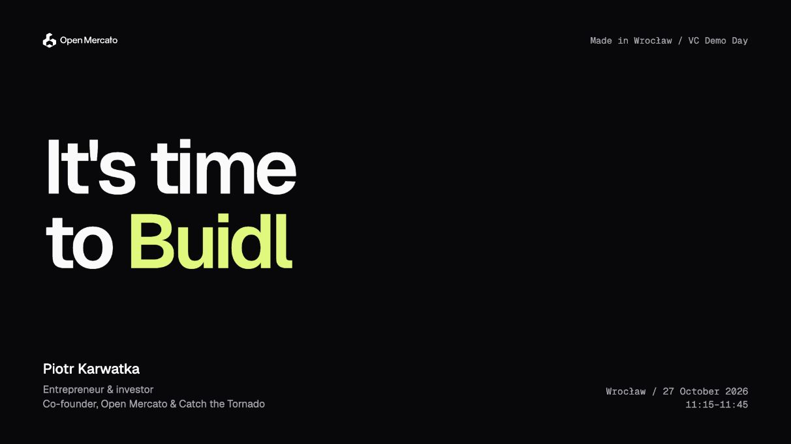
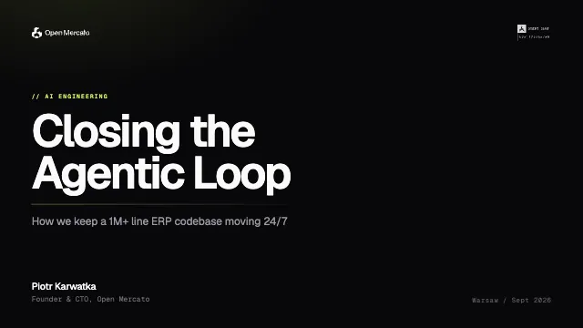
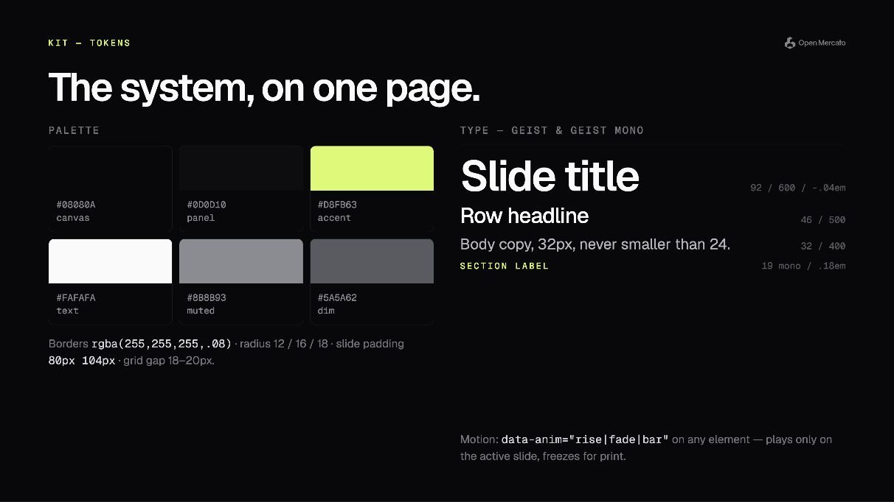
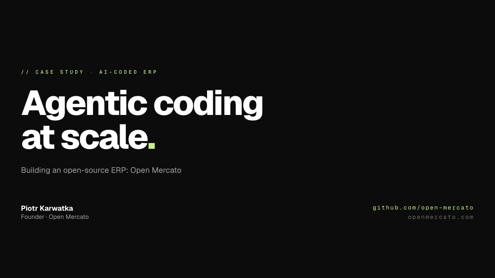
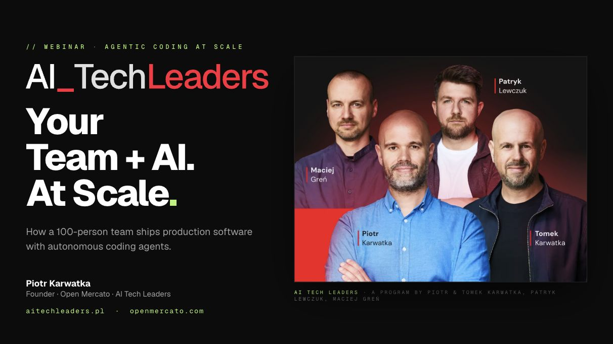

<p align="center">
  
</p>

<h1 align="center">Open Mercato Decks</h1>

<p align="center">
  Conference talks, webinars and a reusable slide kit by Piotr Karwatka and the Open Mercato team.<br>
  HTML presentations with local previews and Cloudflare hosting.
</p>

<p align="center">
  <a href="https://pkarw-decks.openmercatocloud.com">Browse the live deck library</a>
</p>

## Decks

Click a title or screenshot to open its HTML presentation. Serve the files over HTTP using the local server below.

| Preview | Deck | About |
| --- | --- | --- |
| [](decks/its-time-to-build.dc.html) | [It's time to Buidl](decks/its-time-to-build.dc.html) | Made in Wrocław VC Demo Day keynote, 27 October 2026, 11:15–11:45. Building with AI, customer demand, capital efficiency and lessons from the portfolio. 25 slides in English. |
| [](decks/closing-the-agentic-loop.dc.html) | [Closing the Agentic Loop](decks/closing-the-agentic-loop.dc.html) | Agent Conf talk about autonomous coding agents, review and QA in Open Mercato. |
| [](decks/open-mercato-slide-kit.dc.html) | [Open Mercato Slide Kit](decks/open-mercato-slide-kit.dc.html) | Reusable layouts, typography and design tokens for new decks. |
| [](decks/alphalist-cto-ai-engineering-webinar/index.html) | [Alphalist CTO AI Engineering Webinar](decks/alphalist-cto-ai-engineering-webinar/index.html) | Agentic coding at scale, adapted for a CTO audience. |
| [](decks/ai-tech-leaders-live-webinar/index.html) | [AI Tech Leaders Live Webinar](decks/ai-tech-leaders-live-webinar/index.html) | AI engineering practices and workflows from the AI Tech Leaders program. |

## Running locally

```bash
npm start
```

The zero-dependency server serves the repository on `http://localhost:3000`. If that port is busy, use another port:

```bash
PORT=3100 npm start
```

Open `/` for the deck list, or go directly to a presentation:

- `/decks/its-time-to-build.dc.html`
- `/decks/closing-the-agentic-loop.dc.html`
- `/decks/open-mercato-slide-kit.dc.html`
- `/decks/alphalist-cto-ai-engineering-webinar/`
- `/decks/ai-tech-leaders-live-webinar/`

The `.dc.html` decks fetch their own source and load their viewer dependencies over HTTP. Opening them with `file://` will not work. Fonts and some runtime dependencies also require internet access.

The shared slide viewer supports arrow keys and Space to advance, R to reset, a thumbnail rail revealed at the left edge, speaker notes and printing. The two standalone webinar decks have their own viewers.

## Repository layout

```text
decks/       Presentations, thumbnails and deck-specific assets
shared/      Shared viewer, runtime, screenshots and demo recordings
notes/       English speaker notes and talk narratives
index.html   Deck library with screenshot previews
server.js    Local static server
scripts/     Cloudflare packaging and R2 media upload
cloudflare/  Worker serving static assets and video files
```

## Editing a deck

The `.dc.html` presentations contain sibling `<section data-label="...">` elements inside an `<x-import component-from-global-scope="deck-stage" ...>` block. Each section is one slide. Its `data-speaker-notes` attribute stores the notes for that slide.

Use `decks/open-mercato-slide-kit.dc.html` for layout and style references: dark background `#08080A`, accent `#D8FB63`, and Geist / Geist Mono typography. The standalone webinar decks keep their markup and assets in their own directories.

After editing a cover, refresh its thumbnail and use the same screenshot in `index.html` and this README. Keep screenshot paths relative so they work both on GitHub and in local previews.

Speaker-note files:

- [It's time to Buidl](notes/its-time-to-build-talk-notes.md)
- [Closing the Agentic Loop](notes/closing-the-agentic-loop-talk-notes.md)

## Publishing

Production: [pkarw-decks.openmercatocloud.com](https://pkarw-decks.openmercatocloud.com).

Push updates to `main` in [pkarw/decks](https://github.com/pkarw/decks) to trigger the connected Cloudflare deployment. GitHub is the normal publishing path.

To check the static packaging locally:

```bash
npm ci
npm run build:cloudflare
```

The build copies the landing page, decks, shared assets and notes into `.cloudflare/public`. It excludes MP4 files and rejects static files larger than 25 MiB. The `.dc.html` filenames stay intact because the runtime fetches the original filename.

Cloudflare Workers Static Assets serves HTML, scripts and images. The `pkarw-decks-media` R2 bucket holds MP4 recordings, which the Worker streams at their original paths with byte-range support. New or changed recordings need an R2 upload through `npm run upload:media` with Cloudflare authentication.

For a manual deployment when needed:

```bash
npx wrangler login
npm run deploy
```

`npm run deploy` uploads media to R2, prepares the static files and deploys the Worker using `wrangler.jsonc`.

---

<p align="center">
  <sub>Built by <a href="https://github.com/open-mercato">Open Mercato</a>.</sub>
</p>
